<p align="center">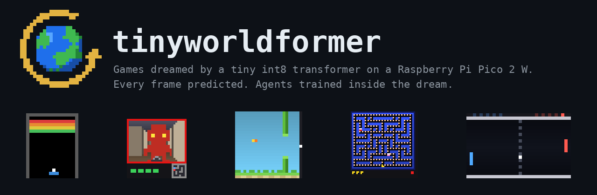</p>

Using 2 small neural networks to generate and play the game at the same time on a Raspberry Pi Pico 2 W. The first one creates the game: given the current frame and the action, it predicts the next frame and the reward. The second one plays that game: it uses the generated frame and picks an action.

| | | | |
|---|---|---|---|
| 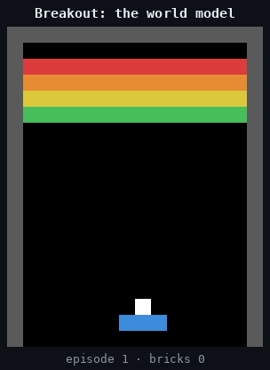 | 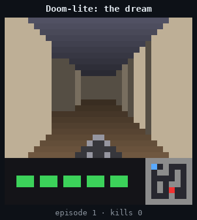 | 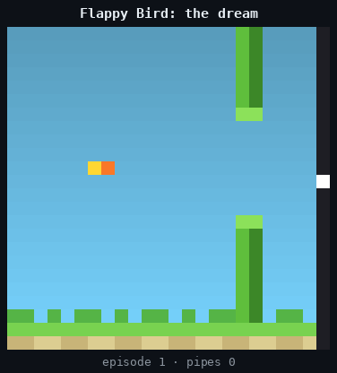 | 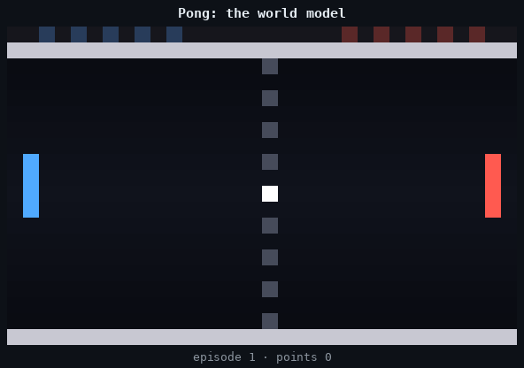 |

Every frame above was sampled by the world model network, and the actions were taken by the actor network.

## Why

I got interested in looped transformers, where one transformer block is applied several times with the same weights instead of stacking different layers. Reusing weights is cheap on memory, so I wanted to see if a looped world model could be small enough to run on a microcontroller. I picked the Pico 2 W because it is cheap and has an FPU, and small games because I could write the real versions directly into numpy and check every generated frame against them. Later I added a streaming RL agent so the board could also learn to play inside its own dream.

Contents: [the two networks](#the-world-model-and-the-actor) · [the games](#the-games) · [the world model](#how-the-world-model-works) · [the agents](#the-agents-stream-x) · [quantization](#quantization-and-the-pico) · [on the chip](#on-the-chip) · [flashing](#flashing-a-game-and-an-agent) · [browser](#in-the-browser) · [reproduce](#reproduce) · [code layout](#code-layout)

## The world model and the actor

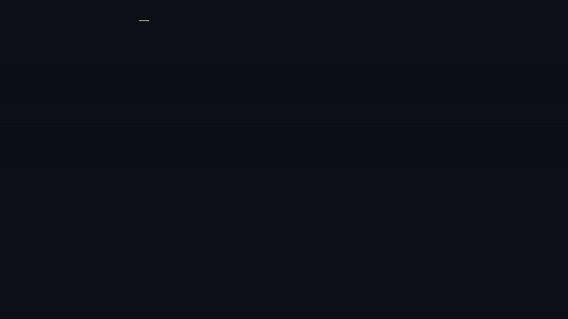

| | network 1: the world model | network 2: the actor |
|---|---|---|
| job | frame + action → next frame + reward | frame → action |
| architecture | looped transformer, q int8 | MLP with two hidden layers, float32 |
| size | 26k–131k parameters | 9k–16k parameters |
| cost per frame | 2–8M multiply-adds | 9k–16k multiply-adds |
| trained | on recorded real games ([how](#how-the-world-model-works)) | with stream-x, in the real game or inside the dream ([how](#the-agents-stream-x)) |

The size depends on the game, some games require more parameters to learn them to be playable, we tried to get to keep the number of the parameters small enough.


On the chip neither network ever uses the real game: the actor only sees frames the world model, and the world model only gets actions from the actor. Both run on core 1 of the RP2350, while core 0 handles USB and the display.

The pretrained actor can be swapped for a fresh stream-x agent that learns from scratch on the board. And any button press hands control to you, so you can play the dream yourself.

## The games

Each game is a few hundred lines of numpy in `src/tinyworldformer/games/`. It renders to a small grid of token ids, and one frame always holds the whole game state, so hidden state has to be drawn into the frame: the ball's heading is part of its token, and Doom-lite has a minimap.

| game | frame | rules | random event | world model | exact frames, 2 loops |
|---|---|---|---|---|---|
| Breakout | 20×16 | paddle, ball, 56 bricks, 5 lives | the serve after a miss | 26k params, 4.3M MACs | 99.99% |
| Doom-lite | 32×32 | raycast first-person view of an 8×8 maze; an enemy walks shortest paths to you; you shoot | the enemy's respawn | 55k params, 4.2M MACs | 83.6% (see below) |
| Flappy Bird | 24×24 | gravity, flaps, scrolling pipes | the next gap height | 46k params, 2.0M MACs | 100% |
| Pong | 20×32 | you against a CPU paddle that reacts late, first to 5 | the serve after a point | 46k params, 2.3M MACs | 99.45% |
| Pac-Man lite | 48×48 | 23×21 maze, 249 pellets, two ghosts on shortest paths, 3 lives | the ghosts' respawn | 131k params, 8.2M MACs | 86.4% |

"Exact frames" is the share of held-out transitions where every cell of the predicted frame matches the real game. Frames right after a random event are left out, since those can only be sampled, not predicted. Doom-lite's 3D view has 768 cells and a single shaded wall pixel off counts the whole frame as wrong, so its number looks worse than it plays; the game state is almost always right (see [checking the dream](#checking-the-dream)).

You can play the real games in a terminal: `uv run python -m tinyworldformer.games.play --game pacman` (or `breakout`, `doomlite`, `flappy`, `pong`).

## How the world model works

### Frames split into tokens

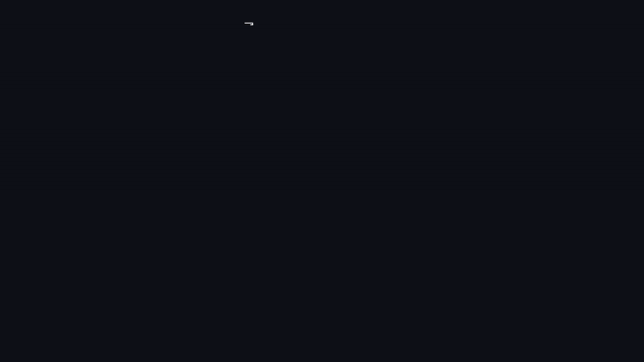

The frame is cut into square patches: 2×2 cells in Breakout, 4×4 in Doom-lite, Flappy Bird and Pong, 6×6 in Pac-Man. That gives 36 to 80 tokens per game. A patch's embedding is the sum of one learned vector per cell, with a separate table for each position inside the patch so the cell order isn't lost. Every token also gets a position vector and the action's vector.

### Looped Transformer

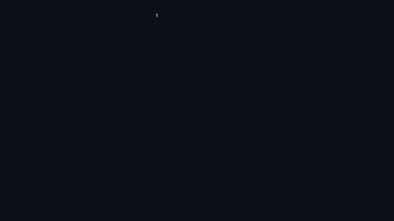

The model is a single transformer block (attention plus a ReLU MLP) with one set of weights, applied 1 to 4 times, with the input added back before every pass. The output after every pass is trained against the next frame, so at run time the loop count trades speed for accuracy. On the Pico to keep a decent frame rate we use uses two loops.

The animation shows one held-out Doom-lite step. After one pass the model draws an enemy that isn't there, and each further pass removes part of it: 92, 35, 12, then 0 wrong cells. The bars on the right are the share of held-out frames each loop count gets exactly right.

Here is a dreamed Doom-lite step decoded after 1, 2, 3 and 4 loops, with red boxes on cells that differ from the real rules:

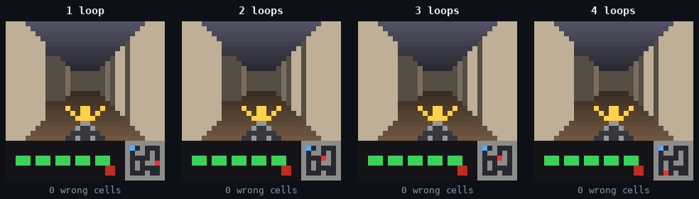

Exact held-out frames by loop count:

| loops | Breakout | Doom-lite | Flappy Bird | Pong | Pac-Man |
|---|---|---|---|---|---|
| 1 | 99.68% | 59.8% | 99.99% | 98.47% | 79.6% |
| 2 | 99.99% | 83.6% | 100% | 99.45% | 86.4% |
| 3 | 100% | 85.9% | 100% | 99.60% | 85.7% |
| 4 | 99.96% | 84.7% | 100% | 99.53% | 84.4% |

### Decoding

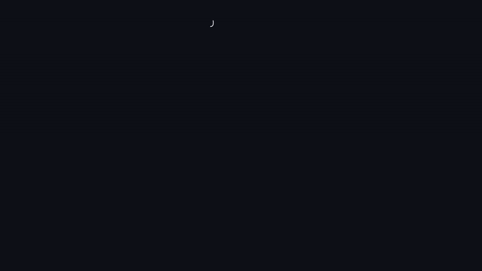

The model outputs a score for every cell and every token. Turning those scores into a frame turned out to matter almost as much as the model, and it ended up as three rules (shown above on Pong):

1. Background cells (walls, bricks, pellets, floor) each take their most likely token independently.
2. Singletons (the ball, the player, each ghost) are placed with one choice over all (cell, token) pairs, so there is always exactly one of each. After a random event the choice is sampled among candidates within 2.2 logits of the best, so the world model samples a new serve or respawn instead of averaging them.
3. Pac-Man and the ghosts are 2×2 sprites, but only one cell of each carries state (the mouth holds the heading; the ghost's lower-left cell holds whether a pellet is underneath). The other three cells are stamped from it instead of predicted.

We implemented Rule 2 because the first Breakout model drew two balls at once; one global choice took exact frames from 91.6% to 99.7%.

### Checking the world model

Accuracy on recorded data wasn't enough. An agent drives the dream into states the data never had, and any mistake there is something it can exploit. So the main check runs while an agent plays: read the game state back off the dreamed frame (`games/<game>.py: read`), apply the real rules to that state and the agent's action, and compare the result with the next dreamed frame and reward.

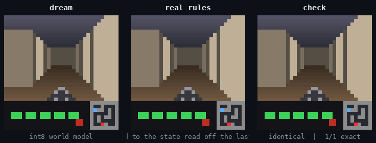

5,000 dreamed steps per game at 2 loops, with the shipped agent (`training/evalwm.py --agent`):

| game | wrong game states | wrong rewards | wrong cells per step |
|---|---|---|---|
| Breakout | not read back; 0 frames with impossible tokens | 6 (paid without a brick breaking) | – |
| Doom-lite | 1 | 0 | 1.50 |
| Flappy Bird | 0 | 0 | 0.00 |
| Pong | 1 | 0 | 0.00 |
| Pac-Man | 742 | 38 | 0.39 |

### Training

First, agents play the real game and every step is recorded as one example (frame, action, next frame, reward), 1–3 million per game. Some episodes start from unusual states, like bricks with holes or random positions, so the data covers more of the game.

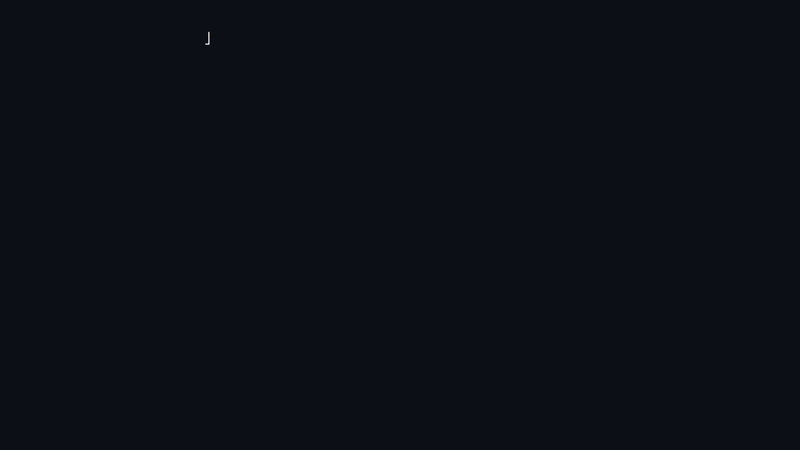

Then the world model learns to predict the next frame with a per-cell cross-entropy loss: 30k steps, with the first 3–4k steps run in float, then int8 rounding switches on ([QAT](#quantization-and-the-pico)).

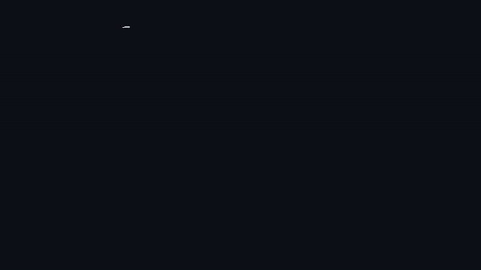

The int8 weights are written into Rust source with every float stored as its exact bits. We check them with `cargo test` to reproduces the Python integer spec bit for bit, and then the firmware runs on the Pico.

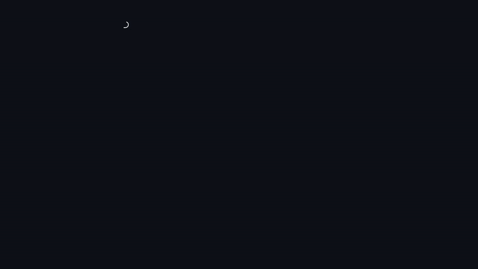

An agent trained in the world model reaches states the recorded data never had, so record real games with that agent and fine-tune the world model on everything.

The agent in different games stated exploiting them so those are some fixes to it:

- Weighting the loss by "this cell changed" biased the model toward predicting change, so it drew two balls and broke two bricks. Weighting by where things can happen in the input frame, plus the global singleton choice, fixed it.
- A Breakout agent in the dream got 154 points with 26 bricks left, because the world model didn't remove bricks from the corner when it were hit. Doom-lite agents learned to snipe from 5 cells away.
- Agents trained only in the dream scored 210 there (the real maximum is 56) and 28 in the real game, as *World Models* (Ha & Schmidhuber) predicts. Each collect-and-fine-tune round closed the exploit that agent had found.
- The Doom-lite dream sometimes lost the enemy sprite and never drew it again: the model copied the previous view instead of redrawing it from the minimap. Noise augmentation fixed it (`train --noise 0.3`, as in GameNGen): input views get random pixels and sometimes lose the sprite.
- `d=32` couldn't absorb the wider Breakout data and `d=48` could. Pac-Man's 48×48 frame needed `d=64`.

## The agents: stream-x


The agents use Stream AC(λ) (Elsayed, Vasan & Mahmood, 2024), which learns from one transition at a time: no replay buffer, no batches, no target network. Eligibility traces carry credit back in time, and ObGD shrinks any step that would overshoot the TD target. The policy and value networks each have two hidden layers of 64 units (32 on the Pico) with LayerNorm.

The input is a feature vector read off the frame (`training/streamx.py: observe_*`, mirrored in Rust in `tinyworldformer-rs/src/agent.rs`). For example, the ball's row, column and heading in Breakout, or in Pac-Man, for each direction, the shortest-path distance to the nearest pellet and how close each ghost is.

Below is one training run per game (real game, 500k steps) at six stages: untrained, the end, and the snapshots where the score has covered 25, 50, 75 and 95% of the way. Each panel plays greedily from the same start and skips a few steps per frame. "try" counts the episodes played so far, so you can see the crashes.

**Breakout**
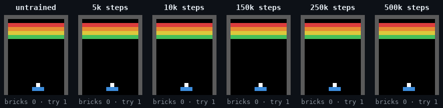

**Doom-lite**
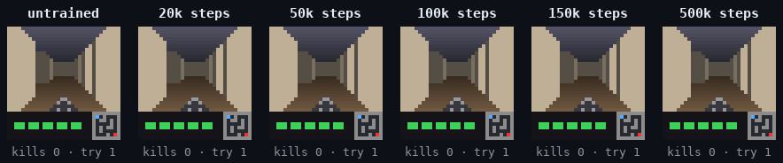

**Flappy Bird**
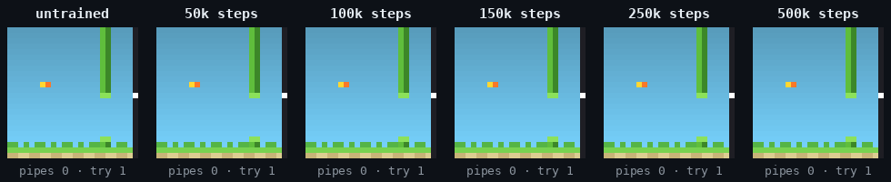

**Pac-Man lite**
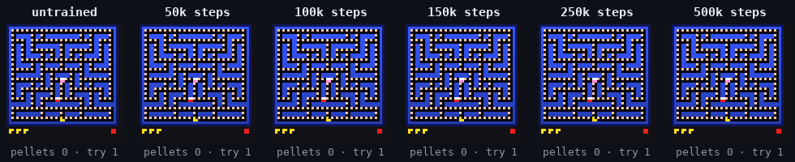

**Pong**
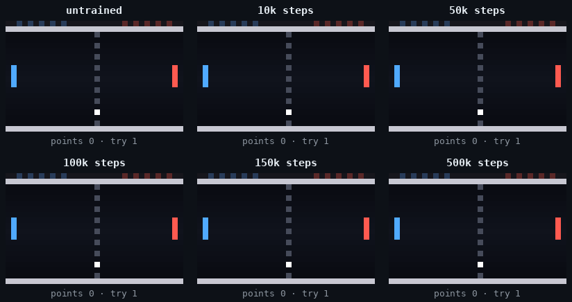

Greedy return in the real game, mean of 10 episodes, at snapshots of the same run:

| game | 0 | 1k | 2k | 5k | 10k | 20k | 50k | 100k | 150k | 250k | 500k | max |
|---|---|---|---|---|---|---|---|---|---|---|---|---|
| Breakout | 8.2 | 17.0 | 15.9 | 21.9 | 29.9 | 29.9 | 29.9 | 31.1 | 35.0 | 39.9 | 45.6 | 56 |
| Doom-lite | −5.0 | −5.0 | −5.0 | −5.0 | −5.0 | 59.5 | 69.9 | 78.1 | 81.8 | 82.1 | 82.9 | – |
| Flappy Bird | −1.0 | −1.0 | −1.0 | 1.9 | 24.6 | 24.9 | 96.2 | 123.7 | 309.2 | 332 | 332 | 332 |
| Pac-Man | 7.0 | 3.8 | 17.0 | 17.7 | 8.2 | 46.8 | 72.9 | 138.9 | 146.6 | 190.3 | 217.4 | 249 |
| Pong | −4.3 | −3.9 | −3.9 | −3.9 | −1.7 | −2.0 | −0.3 | 1.1 | 1.7 | 1.1 | 1.1 | 5 |

Without shaping, Doom-lite agents camp in the start corner and fire, because the enemy always comes to them. `--idle-penalty 0.1` costs 0.1 for each step spent in a cell visited more than 6 times in the last 20 steps. The position is read off the minimap, so the penalty works inside the dream too. With it the agent patrols and gets twice the kills.

`tinyworldformer-rs/src/learner.rs` is the same algorithm in `no_std` Rust, with the backward pass written by hand. It matches 200 PyTorch updates to within 3.5e-6. On the host, a fresh agent inside the Rust int8 Flappy Bird dream averages 6 pipes per episode after 25k steps, 121 after 100k, and 300+ after 250k.

## Quantization and the Pico


Every matrix in the world model is int8 with one scale per output row (`scale = max|w| / 127`). Activations are int8 too, with one scale per tensor and per loop index, since the loops see different ranges. Matmuls sum int8 × int8 into int32 (two multiply-adds per `SMLAD` instruction on the RP2350) and then apply one float multiply by the two scales. Softmax uses a 1024-entry exp table, with probabilities stored as uint8. Norms, residuals and embeddings stay in float32, since the RP2350 has an FPU.

Training applies the same rounding (QAT with a straight-through estimator), so the int8 model is the model that was trained. `rustexport/intref.py` is the int8 model in numpy with every float operation in a fixed order; the Rust engine reproduces it bit for bit, and `cargo test` checks golden vectors for every exported env.

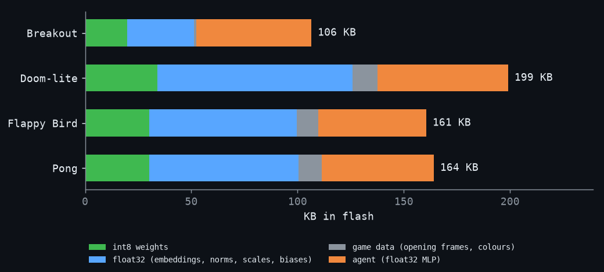

| game | int8 weights | float32 (embeddings, norms, scales) | game data | agent (float32) | firmware flash | firmware RAM |
|---|---|---|---|---|---|---|
| Breakout | 19.7 KB | 31.6 KB | 1.1 KB | 54.1 KB | 361 KB | 299 KB |
| Doom-lite | 33.9 KB | 91.9 KB | 12.0 KB | 61.3 KB | 471 KB | 357 KB |
| Flappy Bird | 30.1 KB | 69.5 KB | 10.1 KB | 50.8 KB | 409 KB | 227 KB |
| Pong | 30.1 KB | 70.4 KB | 10.9 KB | 52.6 KB | 414 KB | 244 KB |

Flash and RAM are measured from the firmware ELF (`size -A`), built with the Display Pack driver, so they include the code, USB, the display driver and the on-device learner. The Pico 2 W has 4 MB of flash and 520 KB of SRAM, 512 KiB of it in the main memory map. The float32 embedding tables are the largest part and could be int8 too.

`src/tinyworldformer/rustexport/` imports only numpy and torch (a test keeps it that way), so other projects can reuse the export: build a model from `rustexport.qat` (`QLinear`, `LoopedBlock`), train it with `ActQuant.enabled = True` after a float warm-up, convert it with `rustexport.convert.looped_model`, then write the Rust source with `int_model_arrays`, `mlp_arrays` and `codegen.write_module`. `rustexport.Golden` writes the vectors a Rust test checks.

## On the chip

The firmware (`tinyworldformer-rs/firmware`) is `no_std` Rust on embassy. Nothing is allocated at run time: the weights are `static` arrays in flash, and every buffer is a fixed-size `static` in RAM.

Core 1 runs the game. One pass of its loop (`dream_loop` in `firmware/src/main.rs`) is one frame:

1. The actor reads features off the current frame (`agent::observe`) and runs its MLP to pick a button. If on-device learning is on, the learning agent picks instead; if you are pressing buttons, your press is used.
2. The int8 transformer runs 2 loops over the frame and the button (`Engine::forward`), and decoding turns its scores into the next frame: background argmax per cell, each singleton placed once (sampled for random events with an xorshift RNG), then the sprite stamps. The reward is the argmax of the reward head; lives and episode ends are counters on top.
3. If learning is on, the learner updates from this one transition and then forgets it.
4. The frame goes to core 0 through a two-slot channel. If core 0 is still busy with the previous frame, this one is dropped, so core 1 never waits for the screen.

When you play, core 1 slows down to a playable speed (66–150 ms per frame, depending on the game). The agent runs as fast as the chip allows.

Core 0 runs embassy async tasks for everything else. Over USB serial, each frame goes out as coloured ANSI text with a status line (model time, actor time, fps, env and agent names), and keys come back in. The optional Display Pack (`--features display`) is a 320×240 ST7789 over SPI at up to 62.5 MHz, and only cells that changed since the last frame are redrawn. Its buttons are polled every 20 ms. The two cores share only the frame channel and a few atomics: who is playing, the pressed key, learning on/off, and the loop count.

Where the memory goes:

| | in flash | in RAM |
|---|---|---|
| world model | int8 matrices, float32 embeddings, norms and scales, the game's opening frames and colours (52–138 KB) | scratch buffers for one forward pass: activations for 36–80 tokens, the int8 copies the matmuls read, and the per-cell scores of the next frame (114 KB for Flappy Bird up to 368 KB for Pac-Man, whose per-cell scores alone take 184 KB) |
| actor | float32 MLP weights and feature normalization (51–61 KB) | its features and hidden layers (about 1 KB) |
| on-device learner | code only | weights, eligibility traces and normalization for two 32-unit networks (49 KB for Pac-Man up to 106 KB for Doom-lite; it scales with the number of input features) |
| firmware | code, USB, display driver (about 150 KB) | stacks (16 KB for core 1), USB buffers, frame channels |

Every game fits in the 4 MB of flash and 512 KiB of SRAM. Breakout uses 361 KB of flash and 299 KB of SRAM; Pac-Man, the largest, uses 600 KB and 460 KB.

Most of the time goes into int8 dot products (`dot_i8` in `src/lib.rs`). One 32-bit load fetches 4 weights, `SXTB16` unpacks bytes 0/2 and 1/3 into 16-bit halves, and `SMLAD` does two multiply-adds in one instruction. Attention multiplies uint8 probabilities by int8 values, so it uses `UXTB16` instead. Norms, the exp table lookup and the final per-output scale stay in float32 on the FPU. A frame at 2 loops is 2–4M multiply-adds (8.2M for Pac-Man); on a desktop CPU the same Rust code dreams a frame in 0.7 ms (Flappy Bird) to 1.5 ms (Breakout). I haven't measured the frame rate on the Pico itself yet.

The board boots with a fresh agent learning on the device. Press `l` over USB, or hold B for 1 s on the Display Pack, to switch to the pretrained actor, and again to switch back.

## Flashing a game and an agent

Every export sits side by side in the crate: world models in `tinyworldformer-rs/models/envs/<env>/`, agents in `models/agents/<game>/<agent>/`. You pick both at build time.

```bash
cd tinyworldformer-rs
./flash.sh --list                                            # what is exported
./flash.sh --env doomlite --agent doom_agent_roam_p0.3       # build and flash (hold BOOTSEL while plugging in)
./flash.sh --env breakout --display                          # with the Display Pack
./flash.sh --env pong --host                                 # play it in this terminal
./flash.sh --env flappy --default                            # make it the default for plain cargo
TWF_ENV=doomlite TWF_AGENT=doom_agent_roam_p0.1 cargo test --release   # golden tests for that pair
```

Without `--agent`, the agent for the env's game listed in `models/default` is used if there is one, otherwise the first by name. An agent for a different game is refused with a list of the valid ones. The status line on screen shows which env and agent are running.

Keys over USB: Breakout a/d/s, Doom-lite w/a/d/space/s, Flappy space, Pac-Man w/a/s/d, Pong w/s. Then `g` hands back to the agent, `1`–`4` set the loop count, `l` toggles on-device learning and `r` restarts it.

## In the browser

The same `no_std` int8 engine also compiles to WebAssembly (`tinyworldformer-rs/web/`). The module has no imports and no wasm-bindgen, and it runs the firmware's loop: dream, agent, and stream-x learning on the fly. A static page draws the frames on a canvas.

```bash
rustup target add wasm32-unknown-unknown    # once
cd tinyworldformer-rs/web
./build.sh                                   # one module per env into www/ (or ./build.sh pong flappy)
python3 -m http.server -d www                # open http://localhost:8000, ?env=pacman picks a game
```

With the same seed, the wasm build dreams the same episodes as the native build, frame for frame, at 1–5 ms per frame depending on the game. Each module carries its game's default agent; `TWF_AGENT=... ./build.sh <env>` picks another. The keys are the same as on the Pico, plus arrow keys and on-screen buttons, and `f` runs the dream as fast as it can, which helps while learning (`l`).

## Reproduce

```bash
uv sync
G=pong   # breakout, doomlite, flappy, pacman, pong
uv run python -m tinyworldformer.training.data --game $G --transitions 2000000 --varied 0.3   # -> data/$G
uv run python -m tinyworldformer.training.train --data data/$G --d 48 --heads 3 --ff 96 --out models/${G}_wm.pt
uv run python -m tinyworldformer.training.streamx --env real --game $G --out models/${G}_agent.pt
uv run python -m tinyworldformer.training.evalwm --ckpt models/${G}_wm.pt --agent models/${G}_agent.pt   # check the dream
uv run python -m tinyworldformer.training.streamx --env dream --wm models/${G}_wm.pt --out models/${G}_dream_agent.pt
uv run python -m tinyworldformer.training.export --ckpt models/${G}_wm.pt
uv run python -m tinyworldformer.training.streamx --out models/${G}_agent.pt --export tinyworldformer-rs
cd tinyworldformer-rs && TWF_ENV=$G cargo test --release && TWF_ENV=$G cargo run --release
```

Settings that differ per game:

| game | settings |
|---|---|
| Breakout | 1M transitions, `--miss-penalty 5`, then collect with the agent (`data --learned <agent> --holes 0.5 --out data/breakout_learned`) and fine-tune on all of it (`train --init ... --data data/breakout data/breakout_learned --steps 15000 --warmup-float 0 --lr 1e-3`), four rounds |
| Doom-lite | `--varied 0.5`, `train --noise 0.3`, `streamx --max-ep-steps 500 --idle-penalty 0.1` |
| Flappy Bird | `streamx --max-ep-steps 3000` |
| Pac-Man | 1.2M transitions, `--varied 0.4`, `train --d 64 --heads 4 --ff 128 --steps 40000 --warmup-float 4000`, `streamx --miss-penalty 5 --max-ep-steps 1500` |
| Pong | `streamx --max-ep-steps 5000` |

## Code layout

| path | contents |
|---|---|
| `src/tinyworldformer/games/` | the five games (rules, rendering, `read`), the `Game` registry, scripted agents, terminal play |
| `src/tinyworldformer/training/` | data, world model, training, dream checks, stream-x, export to the Rust crate |
| `src/tinyworldformer/rustexport/` | reusable PyTorch → `no_std` Rust export: QAT layers, the int8 spec, conversion, code generation |
| `tinyworldformer-rs/` | `no_std` int8 engine, dream loop, agent and learner; host demo (`src/main.rs`) |
| `tinyworldformer-rs/firmware/` | Pico 2 W firmware |
| `tinyworldformer-rs/web/` | WebAssembly build and the browser page (`www/`) |
