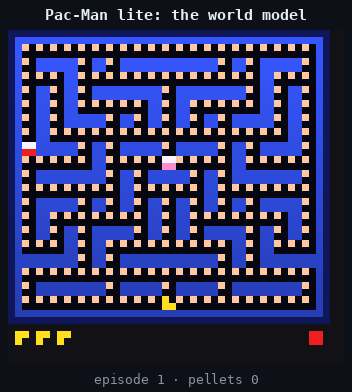

<p align="center"></p>

Two small neural networks share one Raspberry Pi Pico 2 W. One dreams a game: it takes the current frame and a button press, and predicts the next frame and the reward. The other plays that game: it looks at each dreamed frame and picks the button. There is no game code on the chip; five games (Breakout, Doom-lite, Flappy Bird, Pac-Man lite, Pong) exist only inside the first network.


Every frame above is drawn by the dream network, not by game code. The actor network picks the buttons.

- [The dream and the actor](#the-dream-and-the-actor)
- [The games](#the-games)
- [How the world model works](#how-the-world-model-works): tokens, the loop, decoding, checking the dream, training
- [The agents: stream-x](#the-agents-stream-x)
- [Quantization and the Pico](#quantization-and-the-pico)
- [On the chip](#on-the-chip)
- [Flashing a game and an agent](#flashing-a-game-and-an-agent)
- [In the browser](#in-the-browser)
- [Reproduce](#reproduce) and [code layout](#code-layout)

## The dream and the actor


| | network 1: the dream | network 2: the actor |
|---|---|---|
| job | frame + button → next frame + reward | frame → button |
| architecture | looped transformer, int8 | MLP with two hidden layers, float32 |
| size | 26k–131k parameters | 9k–16k parameters |
| cost per frame | 2–4M multiply-adds | 9k–16k multiply-adds |
| trained | on recorded real games ([how](#how-the-world-model-works)) | with stream-x, in the real game or inside the dream ([how](#the-agents-stream-x)) |

- **A closed loop.** On the chip neither network sees the real game. The actor only sees frames the dream drew, and the dream only sees buttons the actor pressed.
- **One core.** Both run on core 1 of the RP2350, one after the other, every frame. Core 0 handles USB and the display.
- **Learning on the chip.** A third network can replace the pretrained actor: a fresh stream-x agent that learns from scratch while it plays inside the dream, on the board.
- **Your turn.** Any button press hands control from the actor to you, so you play the dream yourself.

## The games

Each game is a few hundred lines of numpy (`src/tinyworldformer/games/`). It renders to a small grid of token ids, and one frame always holds the whole game state. Hidden state is drawn into the frame: the ball's heading is part of its token, and Doom-lite has a minimap.

| game | frame | rules | random event | world model | exact frames, 2 loops |
|---|---|---|---|---|---|
| Breakout | 20×16 | paddle, ball, 56 bricks, 5 lives | the serve after a miss | 26k params, 4.3M MACs | 99.99% |
| Doom-lite | 32×32 | raycast first-person view of an 8×8 maze; an enemy walks shortest paths to you; you shoot | the enemy's respawn | 55k params, 4.2M MACs | 83.6% (see below) |
| Flappy Bird | 24×24 | gravity, flaps, scrolling pipes | the next gap height | 46k params, 2.0M MACs | 100% |
| Pong | 20×32 | you against a CPU paddle that reacts late, first to 5 | the serve after a point | 46k params, 2.3M MACs | 99.45% |
| Pac-Man lite | 48×48 | 23×21 maze, 249 pellets, two ghosts on shortest paths, 3 lives | the ghosts' respawn | PACMAN_PARAMS | PACMAN_EXACT |

"Exact frames" counts held-out transitions where every cell of the predicted frame matches the real game, leaving out frames after a random event. A random event can only be sampled, not predicted. Doom-lite's 3D view has 768 cells, so one shaded wall pixel off counts the whole frame as wrong. Its game state is almost always right; see [checking the dream](#checking-the-dream).

| | | | | |
|---|---|---|---|---|
|  |  |  |  |  |

Play the real games in a terminal: `uv run python -m tinyworldformer.games.play --game pacman` (also `breakout`, `doomlite`, `flappy`, `pong`).

## How the world model works

### Frames become tokens


- The frame is cut into square patches: 2×2 cells in Breakout, 4×4 in Doom-lite, Flappy and Pong, 6×6 in Pac-Man. Each game ends up with 36 to 80 tokens.
- A patch's token is the sum of one learned vector per cell. Each position inside the patch has its own table, so the order of the cells is kept.
- Every token also gets a position vector and the action's vector.

### One block, looped


- **One block:** a single transformer block (attention plus a ReLU MLP) with one set of weights, applied 1 to 4 times. The input is added back before every pass.
- **Every pass is trained:** the output after each pass is trained against the next frame, so at run time the loop count trades speed for accuracy.
- **On the Pico:** two loops.

The animation shows one held-out Doom-lite step. After one pass the model draws an enemy that is not there; each further pass removes part of it: 92, 35, 12, then 0 wrong cells. The bars on its right are the share of held-out frames each loop count gets exactly right.

Below, one dreamed Doom-lite step decoded after 1, 2, 3 and 4 loops. Red boxes are cells that differ from the real rules.


Exact held-out frames by loop count:

| loops | Breakout | Doom-lite | Flappy Bird | Pong | Pac-Man |
|---|---|---|---|---|---|
| 1 | 99.68% | 59.8% | 99.99% | 98.47% | PACMAN_L1 |
| 2 | 99.99% | 83.6% | 100% | 99.45% | PACMAN_L2 |
| 3 | 100% | 85.9% | 100% | 99.60% | PACMAN_L3 |
| 4 | 99.96% | 84.7% | 100% | 99.53% | PACMAN_L4 |

### Decoding


The model outputs a score for every cell and every token. Turning the scores into a frame takes three rules, shown above on Pong:

1. **Background** (walls, bricks, pellets, floor): each cell takes its most likely token on its own.
2. **Singletons** (the ball, the player, each ghost): one choice over all (cell, token) pairs, so there is always exactly one. For a random event the choice is sampled among candidates within 2.2 logits of the best, so the dream invents a new serve or respawn instead of averaging all of them.
3. **Stamps:** Pac-Man and the ghosts are 2×2 sprites. Only one cell of each carries state (the mouth holds the heading; the ghost's lower-left cell holds whether a pellet is underneath). The other three cells are drawn from it instead of being predicted. This took Pac-Man from 14% to 65% exact frames with no retraining.

Rule 2 replaced per-cell decoding early on. Decoded cell by cell, the first Breakout model drew two balls at once; one global choice took exact frames from 91.6% to 99.7%.

### Checking the dream

Frame accuracy on recorded data is not enough. An agent drives the dream into states the data never had, and any mistake there is something it can exploit. So the check runs while an agent plays:

1. Read the game state back off the dreamed frame (`games/<game>.py: read`).
2. Apply the real rules to that state and the agent's action.
3. Compare the result with the next dreamed frame, cell by cell, and compare the rewards.


5,000 dreamed steps per game, at 2 loops, with the shipped agent (`training/evalwm.py --agent`):

| game | wrong game states | wrong rewards | wrong cells per step |
|---|---|---|---|
| Breakout | not read back; 0 frames with impossible tokens | 6 (paid without a brick breaking) | – |
| Doom-lite | 1 | 0 | 1.50 |
| Flappy Bird | 0 | 0 | 0.00 |
| Pong | 1 | 0 | 0.00 |
| Pac-Man | CHECK_PACMAN |

### Training

**1. Recording.** Agents play the real game, and every step becomes one example: frame, action, next frame, reward. That gives 1–3 million examples per game. Some episodes start from unusual states (bricks with holes, random positions) so the data covers more of the game.


**2. Training.** The world model learns to predict the next frame: a cross-entropy loss per cell, 30k steps, about 45 minutes per game on an RTX 4060 Ti. The first 3–4k steps run in float, then int8 rounding switches on (QAT, see [quantization](#quantization-and-the-pico)). The animation shows one held-out Pong step predicted at six points of a short training run.


**3. Deployment.** The int8 weights are written into Rust source with every float stored as its exact bits. `cargo test` checks that the Rust engine reproduces the Python integer spec bit for bit, then the firmware runs the dream on the Pico.


**4. Closing the loop.** An agent trained in the dream reaches states the recorded data never had. Recording real data with that agent and fine-tuning the world model on everything fixes the dream there.

Each fix below cost a training round to find:

- **Hedging.** Weighting the loss by "this cell changed" biased the model toward predicting change, so it drew two balls and broke two bricks. The fix was to weight by where things can happen in the *input* frame, plus the global choice for singletons.
- **Coverage.** A Breakout agent in the dream got 154 points with 26 bricks left: the dream paid for corner hits without removing the brick. Doom-lite agents snipe from 5 cells away, which scripted play never did. The fix was collecting data with the learned agent.
- **Exploits.** Agents trained only in the dream scored 210 there (the real maximum is 56) and 28 in the real game, as *World Models* (Ha & Schmidhuber) predicts. Each collect-and-fine-tune round closed the exploit that agent had found; Breakout needed four rounds.
- **Copying.** The Doom-lite dream sometimes lost the enemy sprite and never drew it again: the model copied the previous view instead of redrawing it from the minimap. Noise augmentation fixed it (`train --noise 0.3`, as in GameNGen): input views get random pixels and sometimes lose the sprite.
- **Capacity.** `d=32` could not absorb the wider data for Breakout; `d=48` could. Pac-Man's 48×48 frame needed `d=64`.

## The agents: stream-x


Stream AC(λ) (Elsayed, Vasan & Mahmood, 2024) learns from one transition at a time:

- **No buffer:** no replay buffer, no batches, no target network.
- **Updates:** eligibility traces carry credit back in time, and ObGD shrinks any step that would overshoot the TD target.
- **Networks:** a policy and a value network, each two hidden layers of 64 units (32 on the Pico) with LayerNorm.

The input is a feature vector read off the frame (`training/streamx.py: observe_*`, mirrored in Rust in `tinyworldformer-rs/src/agent.rs`). Examples: the ball's row, column and heading in Breakout; in Pac-Man, for each direction, the shortest-path distance to the nearest pellet and how close each ghost is.

Below, one training run per game (real game, 500k steps) at six stages: untrained, the end, and the snapshots where the score has covered 25, 50, 75 and 95% of the way. Each panel plays greedily from the same start and skips a few steps per frame. "try" counts the episodes played so far, so crashes show.

**Breakout**


**Doom-lite**


**Flappy Bird**


**Pac-Man lite**


**Pong**


Greedy return, real game, mean of 10 episodes (snapshots of the same run):

| game | 0 | 1k | 2k | 5k | 10k | 20k | 50k | 100k | 150k | 250k | 500k | max |
|---|---|---|---|---|---|---|---|---|---|---|---|---|
| Breakout | 8.2 | 17.0 | 15.9 | 21.9 | 29.9 | 29.9 | 29.9 | 31.1 | 35.0 | 39.9 | 45.6 | 56 |
| Doom-lite | −5.0 | −5.0 | −5.0 | −5.0 | −5.0 | 59.5 | 69.9 | 78.1 | 81.8 | 82.1 | 82.9 | – |
| Flappy Bird | −1.0 | −1.0 | −1.0 | 1.9 | 24.6 | 24.9 | 96.2 | 123.7 | 309.2 | 332 | 332 | 332 |
| Pac-Man | 7.0 | 3.8 | 17.0 | 17.7 | 8.2 | 46.8 | 72.9 | 138.9 | 146.6 | 190.3 | 217.4 | 249 |
| Pong | −4.3 | −3.9 | −3.9 | −3.9 | −1.7 | −2.0 | −0.3 | 1.1 | 1.7 | 1.1 | 1.1 | 5 |

Breakout: bricks minus lost balls. Doom-lite: kills minus hits in 500 steps. Flappy Bird: pipes in 3,000 steps. Pac-Man: pellets minus lives lost. Pong: points won minus lost in 3,000 steps.

- **Flappy Bird** reaches the maximum by 250k steps.
- **Breakout** is still improving at 500k; the 1M-step agents clear the board (56.0).
- **Pong**'s agent learns not to miss, then plateaus: beating the CPU needs angled shots off the paddle's ends, which it rarely finds.

**Trained only in the dream.** These agents never saw the real game. Scores are measured in the real game (greedy, 50 episodes):

| game | agent | real-game score |
|---|---|---|
| Breakout | 1M dream steps, −5 per lost ball | 54.4 of 56 bricks |
| Doom-lite | 300k dream steps, idle penalty 0.1 | 81.6 kills per 500 steps |

Without shaping, Doom-lite agents camp in the start corner and fire: the enemy always comes to them. `--idle-penalty 0.1` costs 0.1 for each step spent in a cell visited more than 6 times in the last 20 steps. The position is read off the minimap, so the penalty works inside the dream too. With it the agent patrols and gets twice the kills.

**Learning on the Pico.** `tinyworldformer-rs/src/learner.rs` is the same algorithm in `no_std` Rust, with backpropagation written by hand. It matches 200 PyTorch updates to within 3.5e-6. On the host, a fresh agent inside the Rust int8 Flappy dream averages 6 pipes per episode after 25k steps, 121 after 100k, and 300+ after 250k.

## Quantization and the Pico


- **Weights:** every matrix in the world model is int8, with one scale per output row (`scale = max|w| / 127`).
- **Activations:** int8, with one scale per tensor and per loop index (the loops see different ranges).
- **Matmuls:** int8 × int8 sums into int32 (two multiply-adds per `SMLAD` instruction on the RP2350), then one float multiply by the two scales.
- **Softmax:** a 1024-entry exp table, with probabilities stored as uint8.
- **Float32:** norms, residuals and embeddings. The RP2350 has an FPU.
- **QAT:** training applies the same rounding (straight-through estimator), so the int8 model is the model that was trained.
- **Bit-exact:** `rustexport/intref.py` is the int8 model in numpy with every float operation in a fixed order. The Rust engine reproduces it bit for bit, and `cargo test` checks golden vectors for every exported env.


| game | int8 weights | float32 (embeddings, norms, scales) | game data | agent (float32) | firmware flash | firmware RAM |
|---|---|---|---|---|---|---|
| Breakout | 19.7 KB | 31.6 KB | 1.1 KB | 54.1 KB | 361 KB | 299 KB |
| Doom-lite | 33.9 KB | 91.9 KB | 12.0 KB | 61.3 KB | 471 KB | 357 KB |
| Flappy Bird | 30.1 KB | 69.5 KB | 10.1 KB | 50.8 KB | 409 KB | 227 KB |
| Pong | 30.1 KB | 70.4 KB | 10.9 KB | 52.6 KB | 414 KB | 244 KB |
| Pac-Man | PACMAN_SIZES |

- **Measuring:** flash and RAM are measured from the firmware ELF (`size -A`), built with the Display Pack driver. They include the code, USB, the display driver and the on-device learner.
- **The Pico 2 W:** 4 MB of flash and 520 KB of SRAM (512 KiB of it in the main memory map).
- **Room to shrink:** the float32 embedding tables are the largest part. They could be int8 too.

**Reusing the export.** `src/tinyworldformer/rustexport/` imports only numpy and torch, and a test keeps it that way, so other projects can use it:

1. Build a model from `rustexport.qat` (`QLinear`, `LoopedBlock`).
2. Train it with `ActQuant.enabled = True` after a float warm-up.
3. `rustexport.convert.looped_model` turns it into the integer spec.
4. `int_model_arrays` and `mlp_arrays` with `codegen.write_module` write the Rust source; `rustexport.Golden` writes the vectors a Rust test checks.

## On the chip

The firmware (`tinyworldformer-rs/firmware`) is `no_std` Rust on embassy. Nothing is allocated at run time: the weights are `static` arrays in flash, and every buffer is a fixed-size `static` in RAM.

**Core 1 runs the game.** One pass of its loop (`dream_loop` in `firmware/src/main.rs`) is one frame:

1. **The actor picks a button.** It reads features off the current frame (`agent::observe`) and runs its MLP. If on-device learning is on, the learning agent picks instead. If you are pressing buttons, your press is used.
2. **The dream draws the next frame.** The int8 transformer runs 2 loops over the frame and the button (`Engine::forward`). Decoding turns its scores into the next frame: background argmax per cell, each singleton placed once (sampled for random events, with an xorshift RNG), then the sprite stamps. The reward is the argmax of the reward head, and lives and episode ends are counters on top.
3. **The learner updates** (if learning is on), from this one transition, then forgets it.
4. **The frame goes to core 0** through a two-slot channel. If core 0 is still busy with the previous frame, this one is dropped: core 1 never waits for the screen.

When you play, core 1 also slows to a playable speed (66–150 ms per frame, depending on the game). The agent runs as fast as the chip allows.

**Core 0 talks to the outside world** (embassy async tasks):
- **USB serial:** each frame goes out as coloured ANSI text with a status line (model time, actor time, fps, env and agent names). Keys come back in.
- **Display Pack** (optional, `--features display`): a 320×240 ST7789 over SPI at up to 62.5 MHz. Only cells that changed since the last frame are redrawn.
- **Buttons:** polled every 20 ms.

The cores share only the frame channel and a few atomics: who is playing, the pressed key, learning on/off, the loop count.

**Where the memory goes:**

| | in flash | in RAM |
|---|---|---|
| world model | int8 matrices, float32 embeddings, norms and scales, the game's opening frames and colours (52–138 KB) | scratch buffers for one forward pass: activations for 36–80 tokens, the int8 copies the matmuls read, and the per-cell scores of the next frame (114 KB for Flappy Bird up to 368 KB for Pac-Man, whose per-cell scores alone take 184 KB) |
| actor | float32 MLP weights and feature normalization (51–61 KB) | its features and hidden layers (about 1 KB) |
| on-device learner | code only | weights, eligibility traces and normalization for two 32-unit networks (about 85 KB) |
| firmware | code, USB, display driver (about 150 KB) | stacks (16 KB for core 1), USB buffers, frame channels |

The memory map gives 4 MB of flash and 512 KiB of RAM. Every game fits: Breakout uses 361 KB of flash and 299 KB of RAM; Pac-Man, the largest, 600 KB and 460 KB.

**The inner loop.** Most of the time goes into int8 dot products (`dot_i8` in `src/lib.rs`):
- **Loads:** one 32-bit load fetches 4 weights.
- **Unpacking:** `SXTB16` unpacks bytes 0/2 and 1/3 into 16-bit halves.
- **Multiply-adds:** `SMLAD` does two multiply-adds in one instruction.
- **Attention:** its uint8 probabilities times int8 values use `UXTB16` instead of `SXTB16`.
- **Float work:** norms, the exp table lookup and the final scale per output stay in float32 on the FPU.
- **Speed:** a frame at 2 loops is 2–4M multiply-adds. On a desktop CPU the same Rust code dreams a frame in 0.7 ms (Flappy Bird) to 1.5 ms (Breakout). **On the Pico the frame rate is not measured yet:** the firmware is built and sized but has not run on a board.

**Learning at boot.** The board starts with a fresh agent learning on the device. Press `l` over USB, or hold B for 1 s on the Display Pack, to switch to the pretrained actor, and again to switch back.

## Flashing a game and an agent

Every export sits side by side in the crate: world models in `tinyworldformer-rs/models/envs/<env>/`, agents in `models/agents/<game>/<agent>/`. You pick both at build time.

```bash
cd tinyworldformer-rs
./flash.sh --list                                            # what is exported
./flash.sh --env doomlite --agent doom_agent_roam_p0.3       # build and flash (hold BOOTSEL while plugging in)
./flash.sh --env breakout --display                          # with the Display Pack
./flash.sh --env pong --host                                 # play it in this terminal
./flash.sh --env flappy --default                            # make it the default for plain cargo
TWF_ENV=doomlite TWF_AGENT=doom_agent_roam_p0.1 cargo test --release   # golden tests for that pair
```

- **Default agent:** without `--agent`, the env's game's agent from `models/default` is used if it fits, else the first one by name.
- **Wrong game:** an agent for another game is refused, with the list of valid ones.
- **On screen:** the status line shows which env and agent are running.

Keys over USB: Breakout a/d/s, Doom-lite w/a/d/space/s, Flappy space, Pac-Man w/a/s/d, Pong w/s. Then `g` hands back to the agent, `1`–`4` set the loop count, `l` toggles on-device learning and `r` restarts it.

## In the browser

The same `no_std` int8 engine also compiles to WebAssembly (`tinyworldformer-rs/web/`). The module has no imports and no wasm-bindgen. It runs the firmware's loop: dream, agent, and stream-x learning on the fly. A static page draws the frames on a canvas.

```bash
rustup target add wasm32-unknown-unknown    # once
cd tinyworldformer-rs/web
./build.sh                                   # one module per env into www/ (or ./build.sh pong flappy)
python3 -m http.server -d www                # open http://localhost:8000, ?env=pacman picks a game
```

- **Same dream:** with the same seed, the wasm build dreams the same episodes as the native build, frame for frame.
- **Speed:** 1–5 ms per dreamed frame, depending on the game.
- **Agents:** each module carries its game's default agent; `TWF_AGENT=... ./build.sh <env>` picks another.
- **Keys:** the same keys as on the Pico, plus arrow keys and on-screen buttons. `f` runs the dream as fast as it can, which is useful while learning (`l`).

`www/` is a plain static site, so it can be hosted as is. To publish it as a Hugging Face Space (the free CPU tier is enough, since everything runs in the visitor's browser):

```bash
uvx --from huggingface_hub hf auth login     # once
./deploy.sh <user>/tinyworldformer           # builds, creates the static Space if needed, uploads
```

## Reproduce

```bash
uv sync
G=pong   # breakout, doomlite, flappy, pacman, pong
uv run python -m tinyworldformer.training.data --game $G --transitions 2000000 --varied 0.3   # -> data/$G
uv run python -m tinyworldformer.training.train --data data/$G --d 48 --heads 3 --ff 96 --out models/${G}_wm.pt
uv run python -m tinyworldformer.training.streamx --env real --game $G --out models/${G}_agent.pt
uv run python -m tinyworldformer.training.evalwm --ckpt models/${G}_wm.pt --agent models/${G}_agent.pt   # check the dream
uv run python -m tinyworldformer.training.streamx --env dream --wm models/${G}_wm.pt --out models/${G}_dream_agent.pt
uv run python -m tinyworldformer.training.export --ckpt models/${G}_wm.pt
uv run python -m tinyworldformer.training.streamx --out models/${G}_agent.pt --export tinyworldformer-rs
cd tinyworldformer-rs && TWF_ENV=$G cargo test --release && TWF_ENV=$G cargo run --release
```

Settings that differ per game:

| game | settings |
|---|---|
| Breakout | 1M transitions, `--miss-penalty 5`, then collect with the agent (`data --learned <agent> --holes 0.5 --out data/breakout_learned`) and fine-tune on all of it (`train --init ... --data data/breakout data/breakout_learned --steps 15000 --warmup-float 0 --lr 1e-3`), four rounds |
| Doom-lite | `--varied 0.5`, `train --noise 0.3`, `streamx --max-ep-steps 500 --idle-penalty 0.1` |
| Flappy Bird | `streamx --max-ep-steps 3000` |
| Pac-Man | 1.2M transitions, `--varied 0.4`, `train --d 64 --heads 4 --ff 128 --steps 40000 --warmup-float 4000`, `streamx --miss-penalty 5 --max-ep-steps 1500` |
| Pong | `streamx --max-ep-steps 5000` |

## Code layout

| path | contents |
|---|---|
| `src/tinyworldformer/games/` | the five games (rules, rendering, `read`), the `Game` registry, scripted agents, terminal play |
| `src/tinyworldformer/training/` | data, world model, training, dream checks, stream-x, export to the Rust crate |
| `src/tinyworldformer/rustexport/` | reusable PyTorch → `no_std` Rust export: QAT layers, the int8 spec, conversion, code generation |
| `tinyworldformer-rs/` | `no_std` int8 engine, dream loop, agent and learner; host demo (`src/main.rs`) |
| `tinyworldformer-rs/firmware/` | Pico 2 W firmware |
| `tinyworldformer-rs/web/` | WebAssembly build and the browser page (`www/`) |
